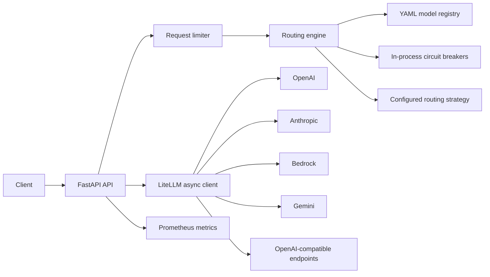
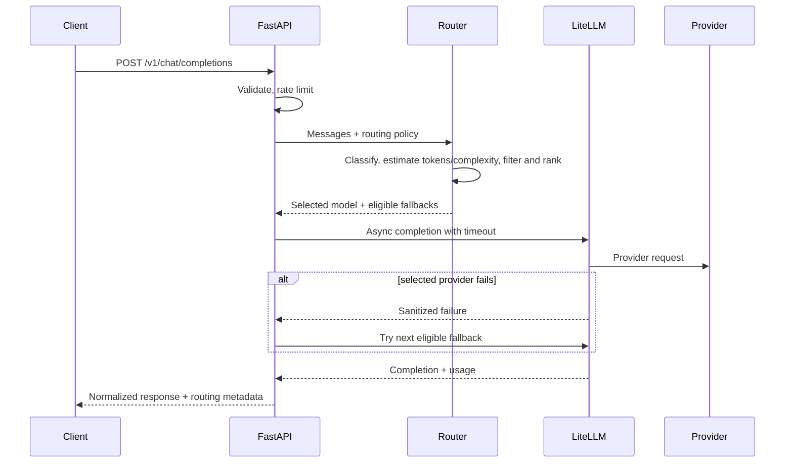

# Intelligent LLM Model Router

A configurable FastAPI service that selects among LiteLLM-supported models using task classification, context limits, capability requirements, cost/latency metadata, and provider health. This is an implementation baseline, not a claim of production readiness: the default registry is intentionally empty, provider credentials and deployment metadata must be supplied by the operator, and the rate limiter/circuit state are process-local.

## Architecture



### Request sequence



## Run locally

Requires Python 3.11+. Create and activate a virtual environment, install development dependencies, copy `.env.example` to `.env`, and configure a non-empty `config/models.yaml` based on `config/models.example.yaml`.

```powershell
py -3.11 -m venv .venv
.\.venv\Scripts\Activate.ps1
pip install -e ".[dev]"
Copy-Item .env.example .env
uvicorn app.main:app --reload
```

The service starts with an empty registry and returns HTTP 503 for routing until models are configured. Fill in verified model IDs, capabilities, context windows, prices, and deployment settings from provider documentation/account configuration. Prices below are per million tokens and are not populated with guesses:

```yaml
models:
  - name: operator-chosen-logical-name
    provider: openai # openai | anthropic | bedrock | gemini | openai_compatible
    model_id: operator-configured-provider-model-id
    capabilities: [coding, reasoning, structured_output]
    context_window: 0 # replace with verified value (must be > 0)
    input_price_per_million: null # set verified current price
    output_price_per_million: null
    expected_latency_ms: null # populate from measured deployment performance
    quality_score: null # populate from your task evaluation
    available: true
    deployment: {} # compatible endpoints can set api_base; never put credentials here
    fallback_group: default
```

Set only the provider credentials needed in the process environment (for example `OPENAI_API_KEY`, `ANTHROPIC_API_KEY`, Google credentials, or AWS SDK credentials/region). LiteLLM resolves these; do not place secrets in the YAML registry. OpenAI-compatible deployments should use `provider: openai_compatible`, the appropriate LiteLLM model identifier, and `deployment.api_base`.

Endpoints: `GET /health`, `GET /v1/models`, `GET /metrics`, `POST /v1/route`, and `POST /v1/chat/completions`. The chat endpoint accepts `messages` and optional `routing` controls: `task_hint`, `quality_tier`, `max_cost`, `max_latency_ms`, `allowed_providers`, and `required_capabilities`. Streaming currently returns 501; see limitations below.

Example request:

```json
{
  "messages": [{"role": "user", "content": "Summarize the following report..."}],
  "routing": {"task_hint": "extraction", "max_cost": 0.01}
}
```

Docker: configure a populated `config/models.yaml` and credentials in the runtime environment, then build and run the included image. Do not bake credentials into the image.

```sh
docker build -t intelligent-llm-router .
docker run --rm -p 8000:8000 --env-file .env -v ./config/models.yaml:/srv/router/config/models.yaml:ro intelligent-llm-router
```

## Routing behavior

The task classifier uses lightweight keyword rules; complexity is a heuristic based on prompt length and task class. Token estimates use a conservative character-based approximation, not provider tokenizers. Models are first filtered for availability, capabilities, provider allowlist, and context capacity, then ranked by the selected strategy (`rule_based`, `cost`, `latency`, `quality`, or `intelligent`). Unknown prices/capabilities remain unknown; populate the registry from verified sources. Current cost ranking treats unpriced models as unknown and cannot enforce a monetary ceiling for them. The router rejects cost-bounded requests if no priced eligible candidate meets the budget.

The circuit breaker is passive and in-memory; it learns from request failures rather than issuing provider health probes. Retries apply to 429 responses and recognizable pre-request connection failures with bounded exponential backoff and jitter. Timeouts are not replayed or failed over because the provider may have completed generation even if the response was lost. Errors returned to callers are sanitized. Prompt text is not logged. Request metrics have bounded labels; request IDs and tenant identifiers are not metric labels.

## Tests

Run `pytest`. Tests use a mocked LiteLLM call and do not make paid provider requests. The suite covers core routing, constraints, and fallback. Load/performance testing is provided as a later operational task; it is not simulated by unit tests.

## Structure

```text
app/                 API, schemas, provider adapter, routing and resilience
config/              empty example registry template
tests/               unit and API integration tests
Dockerfile           container image
pyproject.toml       dependencies and tooling
```

## Limitations before production

- Replace process-local rate limiting and circuit state with shared Redis or gateway controls for multi-worker/multi-replica deployments.
- Add authentication/authorization at an API gateway; the service currently assumes a trusted network boundary.
- Streaming, tenant-specific durable quotas, active provider probes, durable routing history, quality evaluation ingestion, and A/B allocation are not implemented yet.
- Add deployment-specific integration/contract tests, load tests, dashboards/alerts, security review, and provider outage exercises before production use.
- LiteLLM/provider error behavior and model naming must be validated against the exact providers and deployment configurations selected.
